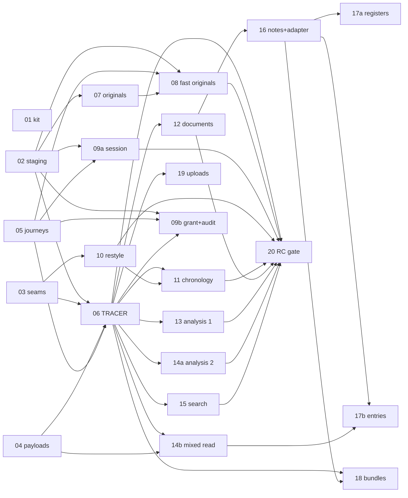

# Sprint tickets: how to pick one up

Each file here is one agent-ready ticket for the 5 November hosted demo (`../spec.md`, `../tickets.md`). The Linear issue of the same title carries the same text. To work: read the sprint block in the repo `AGENTS.md` (01 writes it; until then `../research/agent-protocol.md` section 5) and claim the issue with the three-write claim (`claim:` comment, 15 s, re-read). Then follow the ticket top to bottom: reserved paths, checks, preview walk, one review, merge, comment the merge SHA. Everything else is in `../README.md`.

Rules that apply to every ticket: hosted wrapper pages re-export local pages through `$local` (03), never copy them; `src/lib/components/view-registry.ts` and `docs/plan/view-coverage.json` are never edited; new test files are named `<ticket>-<slug>.test.ts`, placed under a glob `vitest.config.ts` already collects, and belong to that ticket; `src/lib/views/hosted/availability.ts` is edited one line per view by the ticket porting that view (a conflict there is one line, resolved by whoever merges second); the hosted version folder keeps the param name `[version]` (`deploy/client/routes/cases/[caseId]/v/[version]/`), the brief's `[rv]`.

## Dependency graph

**Critical path:** 03 and 04 (0.5–1 d) → 06 (1.5 d) → 12 (1 d) → 16 (1 d) → 17a or 18 (1–1.5 d), about 5 days from Wednesday afternoon to Monday. 02, 05, 07, 08, 09a, 10 run beside it; 09b, 11, 13, 14a, 14b, 15, 19 fan out after 06.

Edges added against `../tickets.md`: 06 ← 05 (budget harness), 08 ← 07 in full and 08 ← 05, 09a ← 05, 09b ← 06 (it edits `services.ts`, `contracts.ts`, `case.server.ts` and `versions.ts` after the tracer), 11 ← 10 (`DataGrid.svelte` and the local chronology page), 19 ← 06 (the intake link is an entry in 06's `case-actions.ts`, not 02).

## Path ownership
A path belongs to one ticket until that ticket merges; a later ticket blocked by it may then take the path (second column). Two tickets that can run at the same time never share a path below. "dir/" is the whole directory; a bare file name is that file only.

| Path | Owner → next |
| --- | --- |
| `.github/workflows/`, `AGENTS.md`, `.agents/skills/goal/`, `.claude/skills/`, `tests/ci/`, `tests/parity/m2-base.test.ts`, `scripts/ci/summary.ts`, `scripts/boat/`, `package.json` | 01 |
| `deploy/staging/` (except `migrations/0008+`), `scripts/deploy-staging.sh`, `scripts/preview.sh`, `deploy/client/wrangler.toml`, `deploy/client/hosted-files.json`, `deploy/probes/clients/` | 02 |
| `src/lib/local-case/model.ts`, `src/lib/case-package/render.ts`, `src/lib/components/views.ts`, `src/lib/components/shell.ts`, `vite.config.ts`, `scripts/ci/hosted-imports.ts`, `tests/hosted-foundation/runtime/{guard-mutations.ts,hosted-imports.test.ts}`, `src/lib/views/hosted/availability.ts` (then one line per porting ticket) | 03 |
| `src/app.css`, `src/lib/components/*.svelte`, `src/lib/components/*.test.ts`, `src/routes/v/[vid]/+layout.svelte`, `deploy/client/routes/+layout.svelte` | 03 → 10 (→ 11 for `DataGrid.svelte`) |
| `src/routes/+layout.svelte`, `static/fonts/`, `src/lib/views/analysis/analysis.css`, `src/lib/views/quantum/quantum.css` | 10 |
| `src/routes/v/[vid]/+layout.server.ts`; `+page.svelte` in `src/routes/v/[vid]/{analysis/timeline,evidence/contracts_tab,evidence/documents,evidence/filings_tab,evidence/search,litigation/elements_tab}/` | 03 (→ 12 documents, 15 search server, 17b filings) |
| `src/routes/v/[vid]/chronology/`, `src/lib/local-case/chronology.ts`, `src/lib/views/evidence/ChronologyPane.svelte` | 03 → 11 |
| `src/routes/v/[vid]/doc/[ref]/` | 03 (`+page.svelte`) → 12 (`+page.svelte`) → 16 (folder) |
| `src/lib/views/payloads.ts`, `src/lib/views/payloads/` (04's files; later tickets add new files), `src/lib/views/overview/`; `+page.server.ts` in the nine mixed route folders; `src/lib/views/evidence/{filings.server.ts,filings.ts}`, `src/lib/views/litigation/{register.server.ts,enforcement.server.ts,enforcement.ts,crossexam.ts,authorities.ts}`, `src/lib/views/quantum/{data.server.ts,payments.ts,interest.ts,settlement.ts}` | 04 (→ 17b for the `.server.ts` files) |
| `tests/journeys/`, `tests/hosted-foundation/budget/{harness.ts,budget.ts,05-existing.test.ts,README.md}` (others add `<nn>-*.test.ts`) | 05 |
| `scripts/publish/` framework and `shards/{shell,overview,list,originals}.ts` (others add `shards/<family>.ts`) | 06 |
| `src/lib/results/hosted/shards.ts`, `src/lib/server/runtime/memory-shards.ts`, `src/lib/server/runtime/hosted/gate/{services.ts,shards.ts}`, `src/lib/views/hosted/{payloads.server.ts,model.ts}`, `deploy/client/routes/cases/[caseId]/+page.server.ts`, `tests/publication/shards/` (others add `<nn>-*.test.ts`) | 06 |
| `src/lib/server/runtime/{contracts.ts,memory.ts}`, `src/lib/server/runtime/hosted/services.ts`, `src/lib/results/hosted/versions.ts` | 06 → 09b |
| `deploy/client/routes/cases/[caseId]/v/[version]/{+layout.server.ts,+layout.svelte,+page.server.ts,overview/,[category]/}` | 06 |
| `src/lib/views/hosted/overview-slots.server.ts` | 06 → 17a |
| `src/lib/views/hosted/case-actions.ts` | 06 → 19 |
| `scripts/originals/`, `src/lib/storage/cloud/migrations/0003_*`, `tests/hosted-foundation/storage/07-*.test.ts` | 07 |
| `src/lib/results/hosted/{assets.ts,index.ts}`, `src/lib/storage/cloud/{objects.ts,original-facts.ts}`, `src/lib/viewer/hosted/`, `deploy/client/routes/cases/[caseId]/originals/`, `tests/hosted-smoke/originals/`, `tests/hosted-foundation/storage/08-*.test.ts` | 08 |
| `src/lib/auth/`, `src/lib/server/runtime/hosted/{hooks.server.ts,handle.ts,session.ts,bindings.ts,origin-guard.ts}`, `src/lib/server/runtime/hosted/gate/{identity.ts,hooks.server.ts}`, `deploy/client/routes/{sign-in,sign-out}/`, `tests/hosted-foundation/identity/`, `tests/hosted-smoke/auth-routing/`, `tests/hosting-probe/identity/` | 09a |
| `src/lib/tenancy/`, `src/lib/audit/`, `src/lib/views/hosted/case.server.ts`, `tests/hosted-foundation/{audit,upload-grant,case-grant-provisioning,provisioning}/` | 09b |
| `deploy/client/routes/cases/[caseId]/v/[version]/chronology/` | 11 |
| `.../[version]/evidence/documents/`, `.../[version]/doc/`, `scripts/publish/shards/doc.ts`, `src/routes/v/[vid]/evidence/documents/`, `src/lib/views/evidence/documents.ts` | 12 (→ 16 for `.../doc/`) |
| `.../[version]/analysis/{matter,timeline,contradictions_tab,risk_matrix_tab,vdm_matrix_tab,witness_tab}/`, `.../[version]/evidence/{people,entity_ledger_tab}/`, `.../[version]/litigation/conflict_tab/`, `scripts/publish/shards/views-analysis.ts` | 13 |
| `.../[version]/litigation/{elements_tab,legality_tab}/`, `.../[version]/evidence/contracts_tab/`, `.../[version]/quantum/{quantum_tab,invoice_ledger_tab,prescription_tab}/`, `scripts/publish/shards/views-litigation-quantum.ts` | 14a |
| `.../[version]/evidence/filings_tab/`, `.../[version]/quantum/{payments_tab,interest_calc_tab,settlement_tab}/`, `.../[version]/litigation/{enforcement_tab,crossexam_tab,authorities_tab,heads_tab}/`, `.../[version]/analysis/info_required_tab/`, `scripts/publish/shards/views-mixed.ts` | 14b → 17b (except `interest_calc_tab`, `settlement_tab`) |
| `.../[version]/evidence/search/`, `.../[version]/search/`, `.../[version]/evidence/hoa_diff_tab/`, `scripts/publish/shards/search.ts`, `src/lib/views/evidence/{search.ts,diff.ts}`, `src/routes/v/[vid]/evidence/search/+page.server.ts` | 15 |
| `src/lib/views/hosted/{work-adapter.server.ts,notes.server.ts,NoteText.svelte}`, `src/lib/local-case/{answer.server.ts,answer.test.ts}`, `src/lib/user-work/registers.server.ts`, `deploy/client/routes/cases/[caseId]/notes/` | 16 |
| `.../[version]/registers/`, `src/lib/views/registers/`, `src/routes/v/[vid]/registers/` | 17a |
| `src/lib/views/litigation/*.server.ts`, `src/lib/views/quantum/writes.server.ts`, `src/routes/v/[vid]/litigation/`, `src/routes/v/[vid]/quantum/payments_tab/`, `src/routes/v/[vid]/evidence/filings_tab/`, `src/routes/v/[vid]/analysis/info_required_tab/` | 17b |
| `.../[version]/bundles/`, `scripts/publish/shards/{bundle-paths,views-bundles}.ts`, `scripts/bundles/`, `src/lib/views/bundles/`, `src/lib/bundles/`, `src/routes/v/[vid]/bundles/`, `src/lib/user-work/hosted/migrations/0002_*` | 18 |
| `deploy/client/routes/client/intake/`, `deploy/client/routes/operator/submissions/`, `src/lib/submissions/`, `scripts/intake/`, `tests/hosted-smoke/intake/` | 19 |
| `docs/sprint/rc/` | 20 |
| `docs/sprint/runbooks/<nn>-*.md`, `tests/hosted-foundation/budget/<nn>-*.test.ts`, `tests/{analysis,litigation,quantum,calculations,evidence,registers,bundles,system}/<nn>-*.test.ts`, `deploy/staging/migrations/<sprint number>_*.sql` | the ticket in the name |

Frozen for the sprint (nobody edits): `src/lib/results-review/`, `src/lib/server/runtime/hosted/{stepped-stager,candidate-stager,evidence-gate,required-section-render,publication-material*}.ts`, `src/lib/publication/hosted/{rules,readiness,evidence-build}.ts`, `deploy/client/routes/cases/[caseId]/v/[version]/assets/`, `deploy/client/routes/operator/{publication,results,cases}/`, `src/lib/storage/cloud/intake.ts`, `vitest.config.ts`, `view-registry.ts`.

Overlap check: for every pair of tickets where neither is a transitive blocker of the other (wave 0 pairs; 06/07/08/09a/10; 09b with 07, 08, 09a, 10–19; 10 with 12–19; 11–15 with each other and with 16–19; 17a/17b/18/19 with each other), the rows above share no path prefix. The shared-prefix cases (`src/lib/components/*.svelte` 03→10→11; `src/routes/v/[vid]/doc/[ref]/` 03→12→16; `services.ts` 06→09b; `overview-slots.server.ts` 06→17a; `case-actions.ts` 06→19; the 14b route folders → 17b) are all sequential through a blocking edge.

## Sprint D1 migrations (pre-assigned)
Write the SQL once in the library folder at that folder's next free number and add a byte-identical copy under `deploy/staging/migrations/` at the sprint number. Previews share staging's database, so every change is additive.

| Staging file | Library file | Ticket | Content |
| --- | --- | --- | --- |
| `0008_shard_publication.sql` | `src/lib/publication/hosted/migrations/0006_shard_publication.sql` | 06 | `rs_shard_manifest`, `pub_version_signoff` |
| `0009_rs_original_etag.sql` | `src/lib/storage/cloud/migrations/0003_rs_original_etag.sql` | 07 | `rs_original.etag`, `rs_original.media_family` |
| `0010_tenant_grant_lookup.sql` | `src/lib/tenancy/migrations/0004_tenant_grant_lookup.sql` | 09b | covering index, only if the plan needs it |
| `0011_bundle_tables.sql` | `src/lib/user-work/hosted/migrations/0002_bundle_tables.sql` | 18 | `uw_table_definition` rows for the two bundle tables |
| `0012_intake_notification.sql` | `src/lib/submissions/migrations/0003_intake_notification.sql` | 19 | `sub_notification` |
| `0013`, `0014` | reserved | 09a, 20 | unused unless a session or RC fix needs a table |
09a uses KV, not D1; 16, 17a, 17b use the existing `uw_*` tables; 11–15 need no schema.

## Owner actions and what they unblock
| Action | Unblocks |
| --- | --- |
| Enable Zero Trust (team name, Free plan, payment details) | 02 Access on staging and previews; 20 |
| Create the Clerk staging application and hand over its three keys, or authorise an agent to create it | 02 sign-in; 09a |
| Repo secrets `CLOUDFLARE_API_TOKEN`, `CLOUDFLARE_ACCOUNT_ID` | 01's deploy-on-merge workflow |
| One Cloudflare API token per developer | 02 previews from colleagues' machines; every later ticket's preview walk |
| R2 S3 token scoped to `clearcase-staging-files` | 07 originals load; 06 shard upload |
| Pick the intake webhook target and put `CLEARCASE_INTAKE_WEBHOOK` | 19 notification |
| boat.dev seat and `clearcase-golden` build; Greptile on `sprint/**`; confirm the Linear GitHub integration closes issues on sprint merges | 01 |
| Run J1–J10 from the South African network; confirm v5 may be shown to the prospect or supply a scrubbed copy | 20 |
